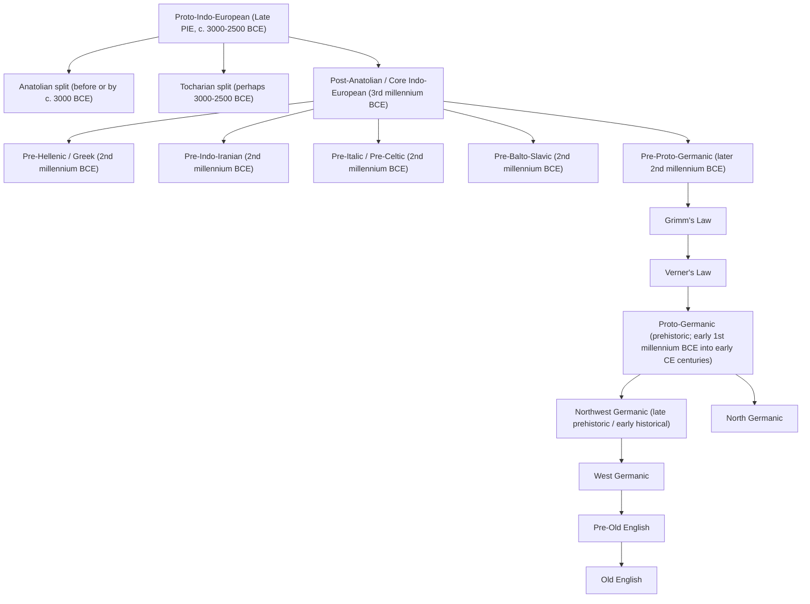

---
tags:
  - old_english
  - linguistics
  - sound_change
---   
This lesson gives you one mental model: first, broad inherited sound changes create Proto-Germanic; later, branch-specific changes shape [Old English](History%20of%20English.md), Old Norse, Old High German, and the rest. Reconstruction works because those outcomes are regular enough to compare.

**Win for today:** by the end, you should be able to place Grimm's Law, Verner's Law, and i-mutation on the same timeline, and explain in one sentence how linguists reconstruct unattested forms.

## 1. The Big Picture

When historical linguists talk about named changes, they are usually talking about different layers of history, not rival explanations. A useful beginner sequence is:

**Proto-Indo-European:** the earlier ancestor, reconstructed rather than directly attested.

**Shared Germanic innovations:** Grimm's Law and Verner's Law help produce Proto-Germanic's characteristic consonant system.

**Later branch changes:** [Old English](History%20of%20English.md), Old Norse, Old High German, and others each continue changing in their own ways.

**Morphological remodeling:** analogy may smooth paradigms and partly hide older phonological history.

If you remember only one distinction, remember this: **Grimm and Verner are early shared consonant history; i-mutation and similar mutations are later branch-level vowel history.** After that, still later processes like syncope, assimilation, gemination, and analogy can reshape what survives on the page.

## 1a. Branching Sketch

This sketch is a rough orientation map, not a last-word family tree. The split dates are approximate and are meant to help you see **relative depth** on the way from PIE to Proto-Germanic and then to [Old English](History%20of%20English.md).

  

The safest reading of this sketch is: **most models place the main Indo-European dispersals in the 3rd millennium BCE, while many daughter branches continue differentiating through the 2nd millennium BCE.** So the later dates in the chart usually mark branch history, not the first start of Indo-European expansion as a whole.

## 1b. Where the Old English Dialects Fit

West Saxon, Mercian, Northumbrian, and Kentish are **not** separate descendants directly branching off from Proto-Germanic alongside Greek or Indo-Iranian. They are much later **dialects inside Old English**, after the path PIE → Proto-Germanic → West Germanic → Pre-Old English has already happened.

|Level|Examples|Why it matters|
|---|---|---|
|Indo-European branch|Germanic, Greek, Indo-Iranian|These are very deep splits in prehistory.|
|Germanic subgroup / language history|Proto-Germanic, West Germanic, Pre-Old English|This is the path that leads specifically toward English.|
|Old English dialect|West Saxon, Mercian, Northumbrian, Kentish|These are later regional varieties inside Old English itself.|

So when you see different OE forms in grammars, glosses, or dictionaries, the question is often not "Which branch of Indo-European is this?" but "Which **Old English dialect** is preserving or innovating this form?" For historical grammar, that matters because some changes spread unevenly. A sound change may look regular in West Saxon, but show a different outcome, timing, or spelling in Northumbrian or Kentish.

**Quick dialect cues:** West Saxon is the dominant literary dialect for many surviving texts, so learners often mistake it for "Old English as a whole." Northumbrian and Mercian belong to the Anglian area and often preserve different vowel developments or earlier/later sound-change timing. Kentish is the southeastern dialect and can show its own vowel spellings and developments. So the dialects factor in as a **late interpretive layer** on top of the older Germanic history, not as rivals to Grimm's Law or Verner's Law.

## 2. How the Famous Laws Fit Together

**Grimm's Law** is the big consonant shift from Proto-Indo-European into Proto-Germanic: roughly, PIE voiceless stops become fricatives, voiced stops become voiceless stops, and voiced aspirated stops become voiced fricatives/stops. The University of Texas Proto-Germanic phonology chapter gives the compact standard statement of this shift [here](https://lrc.la.utexas.edu/books/pgmc/2-phonology).

**Verner's Law** explains why Grimm's Law seems to have exceptions. Those "exceptions" turn out to be regular once you account for the older Indo-European accent: some fricatives became voiced when the preceding syllable had not carried the inherited accent.

**i-mutation** is much later. It is a vowel change triggered by a following `i` or `j`, and it is especially visible in Old English alternations like `mann ~ menn` and `fōt ~ fēt`. This is not a rival to Grimm or Verner; it is a later layer.

**Umlaut** in this context is basically another name for this kind of mutation: one vowel changes because a later vowel or glide influences it from the next syllable. **Ablaut** is different: it is an older inherited pattern of vowel alternation inside a word-family or paradigm, not a later local trigger. So `fōt ~ fēt` shows both: inherited ablaut in the older paradigm background, plus later i-umlaut in the plural.

## 2aa. Which Branches Actually Undergo Grimm's Law?

**Only Germanic.** Grimm's Law is not a sound law of Indo-European as a whole. It is one of the major innovations that defines the branch that became Proto-Germanic.

|Branch|Grimm's Law?|Safe beginner reminder|
|---|---|---|
|Germanic|Yes|This is the branch where PIE `p` can become Germanic `f`, as in Latin `pater` beside Gothic `fadar` and OE `fæder`.|
|Anatolian|No|Anatolian has its own early history and split off too early to share Grimm's Law as a Germanic innovation.|
|Hellenic (Greek)|No|Greek preserves a very different consonant history; it does not show the Germanic `p → f`-type shift.|
|Indo-Iranian|No|Indo-Iranian has its own major developments, including satem-type changes, but not Grimm's Law.|
|Italic|No|Italic does not undergo Grimm's Law; Latin `pater` is the classic comparison point against Germanic `fadar`/`fæder`.|
|Romance|No|Romance comes much later from Latin, so it inherits Italic history, not a separate PIE-to-Germanic shift.|

A useful shortcut is this: if a form belongs to **Germanic**, Grimm's Law may be part of its prehistory. If it belongs to **Greek, Sanskrit, Latin, or their descendants**, Grimm's Law is usually there as a _comparison point_, not as the sound change that shaped the form itself.

## 2a. Why Did These Changes Happen?

The honest answer is: linguists often know **that** a change happened and **in what relative order** better than they know its ultimate physical cause. Lehmann explicitly notes that many attempts to explain the first consonant shift have been made, but that none has been widely accepted and the cause may be obscure because the change is so early [here](https://lrc.la.utexas.edu/books/pgmc/2-phonology).

Still, there are useful kinds of explanation. Some changes are **phonetic**: sounds drift because certain articulations are easy to weaken, voice, front, reduce, or assimilate in particular environments. Some are **prosodic**: stress or pitch accent weakens unstressed syllables, which encourages vowel reduction, syncope, and loss of endings. Some are **systemic**: a sound system may reorganize itself as a chain shift. And some are **morphological**: analogy levels paradigms after the phonetic changes have already happened.

That is also the safest general explanation for **loss of intervocalic `h`**. Between vowels, a weak fricative is in a very unstable position: the surrounding vowels keep the airflow open, so the consonant can be reduced and eventually disappear. In other words, this kind of loss is usually treated as ordinary **lenition in a weak environment**, not as a mysterious one-off event.

## 2b. Why This Order?

For many famous changes, the order is inferred from dependency rather than guessed. A short classroom version is:

**Older PIE accent first:** Verner's Law depends on where the inherited accent used to be, so that accent pattern must still have mattered when the voicing happened.

**Grimm before Verner:** Verner's Law operates on the fricatives created by Grimm's Law, so Grimm has to come first.

**Germanic fixed stress later:** Proto-Germanic eventually developed strong initial stress, and once that happened the older mobile accent could no longer feed Verner in the same way. Lehmann treats late Proto-Germanic stress as a later development visible in runic and poetic evidence [here](https://lrc.la.utexas.edu/books/pgmc/2-phonology).

**Branch-specific mutations later still:** changes like i-mutation belong to later Old English or subgroup history, not to the earliest shared Germanic consonant shift.

**Do we know when fixed initial stress appeared?** Not to an exact year. The relative order is much clearer than the calendar date. The safest source-backed teaching claim is that the shift from the older PIE mobile accent system to Germanic fixed initial stress happened **during prehistoric Proto-Germanic**, after the stage needed for Verner's Law but before the breakup into the earliest attested Germanic branches. In other words: early enough to be prehistoric, late enough that it belongs after Grimm and Verner in the usual story.

## 2ba. Rough Timeline for the Main Changes

|Stage or change|Very rough date|What to remember|
|---|---|---|
|Late Proto-Indo-European|roughly 3000-2500 BCE|Mobile accent system and the older stop system belong here.|
|Grimm's Law|roughly later 2nd to early 1st millennium BCE|Usually placed in prehistoric pre-Proto-Germanic or early Proto-Germanic time.|
|Verner's Law|after Grimm, before fixed initial stress|The exact date is uncertain, but it must belong to a stage when the older accent was still active enough to matter.|
|Germanic fixed initial stress|prehistoric Proto-Germanic; exact date uncertain|This is the switch that stops the old PIE-style accent from feeding new Verner-type effects.|
|Common Proto-Germanic stage|roughly last centuries BCE to first centuries CE|Shared Germanic morphology and phonology continue developing after the big consonant shifts.|
|Pre-Old English to early Old English mutations|roughly 5th-7th centuries CE|i-mutation and other branch-specific vowel changes belong here, not back in Proto-Germanic proper.|
|Many classic Old English written-form developments|roughly 6th-9th centuries CE|Breaking, palatalization, contraction, syncope, and leveling belong to the later branch history that shapes the forms you actually read.|

The main caution is this: **the farther back you go, the more secure the sequence is compared with the exact dates.** So "Grimm before Verner before fixed Germanic stress" is much firmer than any single century assignment.

## 2c. The Major PIE Stop Consonants

One traditional way to organize the PIE stop system is the three-way contrast used in standard presentations of Grimm's Law. Lehmann's Proto-Indo-European phonemic inventory includes these obstruents: `p t k kʷ`, `b d g gʷ`, and `bʰ dʰ gʰ gʷʰ`, plus `s` [here](https://lrc.la.utexas.edu/books/piep/13-pie-phonemics).

|Traditional class|Typical members|Why you care|
|---|---|---|
|Voiceless stops|`p t k kʷ`|These are the sounds that Grimm's Law shifts to Germanic fricatives like `f þ h`.|
|Voiced stops|`b d g gʷ`|These typically become Germanic voiceless stops like `p t k`.|
|Voiced aspirated stops|`bʰ dʰ gʰ gʷʰ`|These are the traditional “aspirates” in Grimm's Law and typically become Germanic voiced fricatives/stops.|

**Very rough pronunciation guide:** these symbols are reconstructed, so no one thinks we can hear PIE directly. But a beginner-friendly approximation is still useful.

|PIE symbol|Rough value|Beginner cue|
|---|---|---|
|`p t k`|Plain voiceless stops|Roughly like English `p, t, k`, but imagine them a little less strongly puffed than at the start of English `pin, top, cat`.|
|`kʷ`|Labiovelar stop|A `k`-sound pronounced with lip-rounding at the same time, roughly `kw`.|
|`b d g`|Voiced stops|Roughly like English `b, d, g`.|
|`gʷ`|Voiced labiovelar stop|Roughly `gw`, a voiced partner to `kʷ`.|
|`bʰ dʰ gʰ`|Voiced aspirated stops|Think “voiced stop plus breathy release”: something like `bh, dh, gh`, not English `b` followed by a full separate `h`.|
|`gʷʰ`|Voiced aspirated labiovelar stop|The same breathy release, but with lip-rounding too: very roughly `gwh`.|
|`s`|Voiceless sibilant fricative|Basically `s` as in English `see`.|

You do not need to memorize every reconstructed consonant now. What matters is the shape of the system: historical linguists are comparing **classes**, not just isolated letters.

## 2d. How Did Accent Work in PIE?

A safe beginner summary is that PIE had a **mobile accent system**, not the later Germanic fixed-initial stress system. Lehmann describes early Proto-Germanic as still having a pitch-based accentual system and treats later fixed stress as a later development [here](https://lrc.la.utexas.edu/books/pgmc/1-introduction). In his earlier PIE work he also discusses pitch accent in relation to vowel alternations and accent shifts [here](https://lrc.la.utexas.edu/books/piep/15-development).

For Verner's Law, the only part you need right now is this: if the inherited accent was **not** on the syllable immediately before a Grimm-law fricative, that fricative could become voiced. That is why a form like OE `fæder` can show `d` where a simpler Grimm-only expectation would suggest `þ`.

## 3. A Simple Analogy

Think of a word as carrying several coats of paint from different centuries. Grimm's Law is an older, whole-house repaint. Verner's Law explains why part of that repaint came out differently in certain rooms. i-mutation is a later renovation that affects vowels in a more local way. Analogy is when later speakers repaint a few rooms again so the pattern looks tidier.

## 3a. The Other Processes You Should Expect

**Assimilation** makes neighboring sounds more alike. **Syncope** removes unstressed vowels. **Gemination** lengthens consonants in certain environments. **Breaking** changes a simple vowel into a more complex one near certain consonants. **Palatalization** pulls a consonant forward toward a `y`-like or front-vowel environment. These are not side trivia: they are part of the normal machinery of language change, and they often matter more for reading Old English forms than the grand famous laws do.

## 3c. Old English c/g Palatalization

Old English is one of the places where palatalization becomes very visible in ordinary spelling and pronunciation. Old English Online describes `c` as like `k` in `cold` in guttural environments, but like `ch` in `chin` in certain palatal environments; it likewise describes `g` as a velar sound with guttural vowels but like `y` in `you` with palatal vowels [here](https://lrc.la.utexas.edu/eieol/engol/10).

In practice, this is why modern editors often write dotted `ċ` and `ġ`: not because Old English manuscripts consistently did so, but because the dots help learners keep the palatal values separate from the velar ones.

|Letter|Velar value|Palatal value|Rough cue|
|---|---|---|---|
|`c`|`k`-like|`ch`-like|often written `ċ` in modern teaching texts|
|`g`|`g`-like or fricative/spirant-like by environment|`y`-like|often written `ġ` in modern teaching texts|

Good mental examples are `cild` and `ċild`-type pronunciation history on the one hand, and `ġeard`, `ġiefan`-type `y`-like values on the other. In this repository's own Old English tooling, dotted `ċ` and `ġ` are treated as important enough to preserve explicitly, which matches real learner needs.

## 3d. Is This Just Old English?

Not entirely, but Old English makes it especially prominent. A useful comparison from the LRC materials comes in a discussion of Slavic palatalization that pauses to note a Germanic contrast: Old Norse `skip` keeps the velar `sk` before `i`, while Old English `scip` shows the palatalized development that leads toward modern `ship` [here](https://lrc.la.utexas.edu/eieol/oruol/10).

So the safe beginner takeaway is: **OE belongs to the side of Germanic where front-vowel and `j`-adjacent palatal effects become highly visible; Old Norse and Old High German do not show the same development in the same way.** For now, that contrast is enough. A full cross-Germanic palatalization lesson can wait until you want a branch-by-branch comparison.

## 3b. Sound Words You Should Be Comfortable With

You do not need a full modern phonetics course for Old English, but you do need a compact working vocabulary. These terms are labels for how a sound is physically made, and historical linguists use them constantly because sound changes often target whole classes at once.

|Term|Short description|Rough example|
|---|---|---|
|Vowel|A sound made with relatively open airflow and no strong closure.|`a, e, i, o, u`|
|Consonant|A sound made with more obstruction in the mouth.|`t, f, m`|
|Stop|A consonant with complete closure and then release.|`p, t, k, b, d, g`|
|Fricative|A consonant made by forcing air through a narrow gap, creating friction.|`f, þ, s, h`|
|Sibilant|A particularly hissy or hushing fricative.|`s, z, sh`|
|Nasal|A sound where air flows through the nose.|`m, n`|
|Liquid|A traditional class including `l` and `r`.|`l, r`|
|Glide|A very vowel-like consonant.|`j, w`|
|Voiced|The vocal folds vibrate during the sound.|`z, d, v`|
|Voiceless|The vocal folds do not vibrate during the sound.|`s, t, f`|
|Aspirated|Pronounced with a noticeable puff of breath after release.|like the `p` in English `pin`|

**Why this matters for historical linguistics:** sound changes usually do not target isolated letters. They target classes such as voiceless stops, voiced fricatives, unstressed vowels, or consonants before front vowels. Once you can read those class labels quickly, historical explanations become much less foggy.

## 4. How Reconstruction Works

Linguists reconstruct proto-languages mainly by the **comparative method**. They compare related languages, find recurring sound correspondences, and infer the earlier form that best explains them. The Proto-Germanic introduction at Texas names the comparative method and internal reconstruction as core methods [here](https://lrc.la.utexas.edu/books/pgmc/1-introduction), and the Indo-European Lexicon user guide gives a compact explanation of reconstructed roots and reflexes [here](https://lrc.la.utexas.edu/guides/lex_user).

|Observed fact|Inference|
|---|---|
|Related languages keep showing regular matches, not random ones.|They likely descend from a common source.|
|English `f` often matches non-Germanic `p`.|A regular earlier change probably shifted inherited `p` to Germanic `f`.|
|Some "exceptions" cluster by accent environment.|The exceptions are actually conditioned changes, not chaos.|

So reconstruction is not guesswork in the casual sense. It is inference from repeated structured evidence. It is still hypothetical, which is why reconstructed forms wear the asterisk, but it is constrained hypothesis rather than free invention.

## 4a. Worked Walk-Backs from Old English

Here are three compact examples. This time the point is not just ancestry, but **layering**: Grimm's Law is usually only one step in a chain. A visible Old English form may also reflect inherited ablaut, OE vowel development, loss of `h`, contraction, analogy, or paradigm leveling.

**OE `fōt` "foot"**

PIE root and family evidence: the IE Lexicon gives PIE `*pē̆d-, *pō̆d-` "foot" with reflexes including OE `fōt` and Latin `pes` [here](https://lrc.la.utexas.edu/lex/master/1458). The main walk-back is:

**Cognates to compare:** OE `fōt`, ModE `foot`, Gothic `fōtus`, Old Norse `fótr`, Latin `pēs`, Greek `poús`.

`*pōd-` (PIE) → a Proto-Germanic form of the `*fōt-` type: Grimm gives the regular consonant shifts `p → f` and `d → t`, while the inherited **o-grade vocalism** is what makes this the `fōt`-type member of the paradigm rather than the mutated plural `fēt`. Here `o-grade` just means "the version of the inherited ablaut pattern that contains `o`," as in `*pōd-` beside other related vowel grades → `fōt` (OE), with no special late Old English contraction step needed.

So the useful warning here is different from the one for `tēon`: this word looks simple because it mostly is. The important extra step is not contraction or palatalization, but recognizing that the singular and plural preserve different historical layers: inherited ablaut underneath, and then later i-mutation in forms like `fēt`.

That also explains why the pair `fōt ~ fēt` can look puzzling at first. The trigger for i-mutation was not visible in the surviving monosyllabic forms themselves, but in an **older plural ending**. A common reconstruction is a Proto-Germanic plural of the `*fōtiz` type: the following `i`-sound fronted the root vowel, and later the ending was reduced or lost, leaving the mutated plural `fēt`. The same logic helps with `mann ~ menn`, often traced back to an older plural of the `*manniz` type.

For pronunciation labels in this discussion, the `j` of i-mutation is the glide [j], like the start of English `yes` or German `ja`, not IPA [ʝ]. And the `i` is the high front vowel family, roughly [i] (or long [iː] when long).

Processes to notice: **Grimm's Law**, inherited **ablaut**, and later paradigm layering. What you do _not_ need here is Verner's Law, breaking, gemination, or OE vowel contraction.

**OE `fæder` "father"**

The IE Lexicon gives PIE `pətḗ(r), genitive pətr-és` with reflexes including OE `fæder`, Gothic `fadar`, Latin `pater`, and Sanskrit `pitár-` [here](https://lrc.la.utexas.edu/lex/master/1521). The walk-back is:

**Cognates to compare:** OE `fæder`, ModE `father`, Gothic `fadar`, Old Norse `faðir`, Latin `pater`, Greek `patḗr`, Sanskrit `pitár-`.

`*pətḗr` (PIE) → an early Germanic form of the `*faþēr`-type: Grimm first gives the expected consonant shifts `p → f` and `t → þ` → that still does not explain the historical `d`, so Verner must apply next. The crucial accent fact is in the PIE form itself: `*pətḗr` has the accent on the `-tḗr` syllable, not on the first syllable. So the consonant that became Germanic `þ` was **not** immediately preceded by the inherited accent, and Verner therefore voices it, giving the `d`-type development seen in Gothic `fadar` and OE `fæder`.

So the hidden middle step is exactly the one learners often miss: `t` does not jump straight to `d`. It first becomes the Grimm-style fricative, and only then can Verner's Law voice it. And yes, your stress intuition is right: the later Proto-Germanic fixed initial stress belongs _after_ this stage. By the time you are looking at a Germanic form like `*faþēr`, the accent is no longer in the old PIE position, so `*faþēr` itself is not the form that triggers Verner; it is the earlier accented pre-Germanic stage behind it.

Processes to notice: **Grimm** plus **Verner**. What you do _not_ need here is OE contraction, breaking, or palatalization.

**OE `tēon` "draw, pull"**

The IE Lexicon gives PIE `*deuk-` "to tug, pull, drag, tow" and lists OE `tēon, tēah, tugon, togen`, Gothic `tiuhan`, and Latin `dūcō` among the reflexes [here](https://lrc.la.utexas.edu/lex/master/0355).

**Cognates to compare:** OE `tēon`, Gothic `tiuhan`, Old Saxon `tiohan`, Old High German `ziohan`, Latin `dūcō`.

The less hand-wavey walk-back is:

`*deuk-` (PIE root) → a Proto-Germanic strong-verb preform of the `*teuhan-` type: Grimm gives `d → t`, and the inherited vowel material appears in the Germanic cognates Wright lines up under this root, especially Gothic `tiuhan`, OS `tiohan`, and OHG `ziohan` → pre-OE `*teohan`-type form, because Wright's sound section explicitly treats Germanic `eu` as yielding OE `ēo` in this word-family (§ 32) → OE `tēon`, because Wright's contraction section groups it with forms where intervocalic `h` disappeared and the neighboring vowels contracted (§ 139).

So the immediate answer to "why not `tēhan`?" is: because the `h` between vowels was lost. A plausible phonetic reason is that intervocalic `h` was a weak fricative in a weak environment, and consonants in that position often lenite or disappear. And the answer to "why not `tēan`?" is: because this is not just bare `h`-loss leaving two vowels side by side; in Wright's account the loss triggers a regular Old English **vowel contraction**, producing the contracted infinitive `tēon`. A helpful parallel is `slēan` from earlier `*sleahan`, which Wright cites in the same neighborhood.

The macron matters here. The pre-contraction forms are not usually taken as already containing long `ēa` or `ēo`. Rather, loss of `h` creates a vowel sequence such as `*teoan` or `*sleaan`, and the contraction yields a **long diphthongal outcome**, written `ēo` or `ēa`. So the length belongs to the contracted result, not to an already-long first vowel in the older pre-contraction form.

The usual linguistic explanation is **compensatory lengthening through contraction**: when a consonant disappears and two vowels collapse into one long nucleus, the resulting syllable preserves weight by becoming long. You do not need a more exotic theory than that here; this is a standard kind of historical change.

The rest of the paradigm reminds you that one citation form is not the whole story. Wright also gives the alternation `tēah` : `tugon` : `togen`. In his summary of consonant alternations, he places `tēon` with verbs showing `h ~ g` across the paradigm, just like `flēon ~ flugon` and `slēan ~ slōgon`. So the real historical object is not just `tēon`; it is the whole inherited strong-verb pattern.

Processes to notice: **Grimm's Law**, inherited **ablaut**, OE development of Germanic vowel material, **loss of intervocalic h**, **vowel contraction**, and then paradigm-internal consonant alternation and later leveling. Just as important is what not to force into this example: the key step to the infinitive is _not_ breaking, gemination, or ordinary syncope. This is exactly the kind of word where a single-arrow reconstruction hides too much.

**Two good next examples to try later:** `dēop` "deep" for a cleaner Grimm-plus-vowel-history example, and `fēt` beside `fōt` for seeing i-mutation layered on top of an older inherited noun pattern.

**Method note:** when you reconstruct backward, ask at each step: "Is this difference from the previous stage due to a broad inherited Germanic law, a later Old English sound change, or just a different ablaut grade inside the same paradigm?" That question prevents a lot of false simplification.

## 5. Practice

**Prompt 1.** What kind of thing is i-mutation in this lesson's map?

 Check

**Prompt 2.** What is the main name for reconstructing an unattested ancestor by comparing related languages?

 Check

**Prompt 3.** In one short phrase, what is Grimm's Law in this lesson's map?

 Check

**Prompt 4.** What do we call a consonant made by forcing air through a narrow gap?

 Check

**Prompt 5.** What older feature does Verner's Law depend on?

 Check

**Prompt 6.** What do we call the change that pulls a consonant toward a front-vowel or `y`-like environment?

 Check

## 6. What To Read Next

Your primary source for this lesson is the University of Texas [Proto-Germanic introduction](https://lrc.la.utexas.edu/books/pgmc/1-introduction), then the [phonology chapter](https://lrc.la.utexas.edu/books/pgmc/2-phonology). For Old English-centered follow-up, keep Wright and Wright's _Old English Grammar_ and Bosworth-Toller close by.

## 7. Keep Nearby

- [Reference: Germanic Sound-Change Map](Germanic%20Sound%20Change%20Map.md)
- [Reference: Reconstruction Glossary](Linugistic%20Reconstruction%20Glossary.md)
- [Reference: Sound Terms for Historical Linguistics](Linguistic%20sound%20terms%20for%20Historical%20Linguistics.md)

## Sources Used

- Winfred P. Lehmann, [_A Grammar of Proto-Germanic_, Introduction](https://lrc.la.utexas.edu/books/pgmc/1-introduction).
- Winfred P. Lehmann, [_A Grammar of Proto-Germanic_, Phonology](https://lrc.la.utexas.edu/books/pgmc/2-phonology).
- Winfred P. Lehmann, [_Proto-Indo-European Phonology_, PIE phonemics](https://lrc.la.utexas.edu/books/piep/13-pie-phonemics).
- Winfred P. Lehmann, [_Proto-Indo-European Phonology_, development and accent discussion](https://lrc.la.utexas.edu/books/piep/15-development).
- University of Texas LRC, [Indo-European Lexicon User Guide](https://lrc.la.utexas.edu/guides/lex_user).
- University of Texas LRC IE Lexicon entries for [foot](https://lrc.la.utexas.edu/lex/master/1458), [father](https://lrc.la.utexas.edu/lex/master/1521), and [draw / tug](https://lrc.la.utexas.edu/lex/master/0355).
- University of Texas LRC, [Old English Online, phonology overview](https://lrc.la.utexas.edu/eieol/engol/10).
- University of Texas LRC, [Old Norse comparison material used for the `skip` / `scip` contrast](https://lrc.la.utexas.edu/eieol/oruol/10).
- Joseph Wright and Elizabeth Mary Wright, _Old English Grammar_, used in this workspace through [data/sources/wright.md](/Users/cmalek/src/workspace/wyrdcraeft/data/sources/wright.md), especially the sections on vowel contraction, strong verbs, and consonant alternations.
- Bosworth-Toller, kept as a supporting lexical reference for Old English forms and spellings.

> Ask follow-up questions whenever a term feels slippery. Historical linguistics gets much easier once the terminology is tied to a timeline and a method.