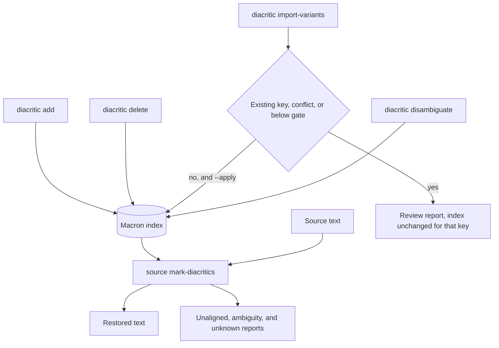

# Diacritic workflows

Restoration consumes the macron index. Curation changes it. They share packaged data under `wyrdcraeft/etc/diacritic/`, including the default index `oe_bt_macron_index.json` and hand-edited palatalization lists.

Normalized keys are lowercased, diacritics are stripped, and `ð` becomes `þ`.

This pass adds marks to a text that lacks them. It is not a substitute for copying an edition that already prints macrons and dots. If PDF extraction drops those marks, this command has to guess them back. [[skills/linguistic-pdf-to-markdown]] is the step that tries to keep the printed marks.

## Mark a text

`wyrdcraeft source mark-diacritics` adds macrons and dot diacritics. It does not alter characters already in the file. A key whose options all share one mark pattern is applied like a unique entry unless that key is completed. Other ambiguous keys follow `--ambiguity-policy` (`auto`, `leave`, or `union`). Completed keys are never guessed. Reports cover unaligned tokens, ambiguity, and unknown words.

Standard elements from `standard_elements.txt` are spelled as listed before transfer. They count only where Bosworth-Toller writes a hyphen after a prefix or around a compound, so `ge-an` and `gēan` stay apart.

## Curate the index

| Command | What it does |
|---|---|
| `diacritic add` | Insert a unique normalized/macron pair. Refuses ambiguous keys. Refuses an existing unique key unless `--force`. |
| `diacritic delete` | Remove a unique pair. |
| `diacritic import-variants` | Add Bosworth-Toller variants as their own unique entries. Dry run unless `--apply`. Never changes an existing key. |
| `diacritic disambiguate` | Interactive resolution of ambiguous entries. `q` leaves the session immediately. |

`CONTEXT.md` still names a hyphenated `diacritic-disambiguate` command. The registered command is `wyrdcraeft diacritic disambiguate`.

`diacritic add` will not overwrite an ambiguous entry. Those keys go through disambiguation. The disambiguation queue skips a key whose options already collapse to one mark pattern; naming that key still opens it.
