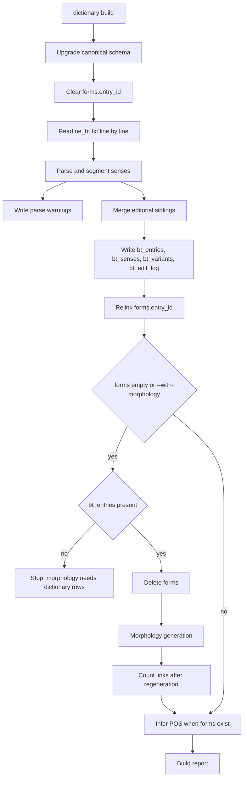

# Dictionary build

`wyrdcraeft dictionary build` is the unified write path into canonical `wyrdcraeft.sqlite3`. The default source is packaged `wyrdcraeft/etc/dictionary/oe_bt.txt`. `--source` overrides it. Optional outputs are a JSON report and `parse_warnings.jsonl`.

One source block becomes one `bt_entries` row. Homographs that share a normalized key and part of speech stay separate blocks. Sense paths such as `1.2` are internal hierarchy, not the printed Bosworth-Toller labels. Those labels stay in `source_label_raw`.

`dictionary clean-headwords` is a source-file cleanup: it lowercases all-uppercase headwords in `oe_bt.txt` before a later build. `dictionary lookup` still runs, prints a deprecation warning, and forwards to `dictionary query`.

## Flow

Unmatched or ambiguous form joins leave `entry_id` null. The relink step clears every `forms.entry_id` and recomputes it. Unapplied edits whose notes start with `target_missing` or `target_ambiguous` are copied into the warnings file.

Morphology is not a separate product command anymore. Generation runs inside this build when `forms` is empty, or whenever `--with-morphology` is passed. See [[projects/wyrdcraeft/concepts/morphology-generation]].

`docs/context/morphology.md` still lists `morphology build`. The live CLI registers build on `dictionary`.
