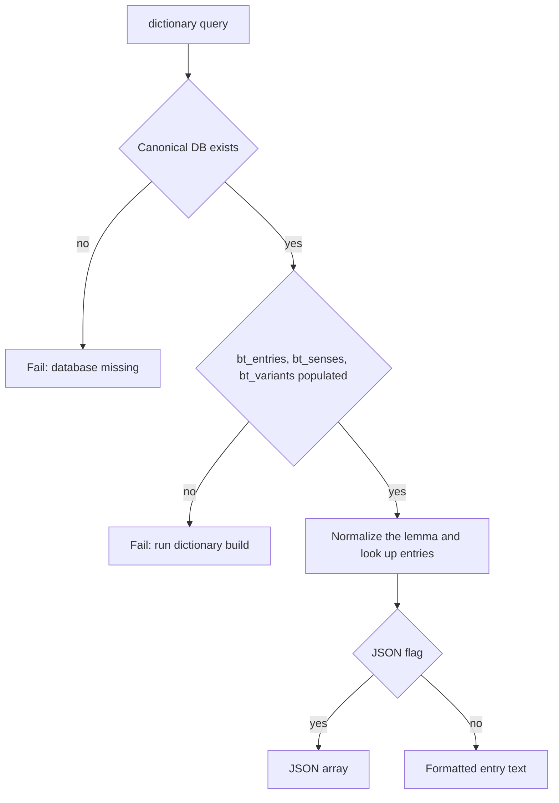

# Dictionary query and browse

Both commands read canonical `wyrdcraeft.sqlite3`. Neither writes dictionary or morphology rows. Rebuild with [[projects/wyrdcraeft/concepts/dictionary-build]] after source changes.

## Query

`wyrdcraeft dictionary query` looks up a lemma or variant spelling, with an optional part-of-speech filter. Output is text or JSON.

The command refuses to run unless `bt_entries`, `bt_senses`, and `bt_variants` are populated. A migrated but empty database is expected until build has run. The hidden `dictionary lookup` command is the same lookup with a deprecation warning.

## Browse

`wyrdcraeft dictionary browse` opens a Textual shell. The search bar is at the top. Results sit on the left. Details and part-of-speech-filtered paradigm grids share the right column. Search accepts æ, þ, ð, macrons, and dotted letters from the keyboard when the field is focused. A character bar under the field covers terminals that cannot emit those keys.

Results sort by rank tier, then by lexical distance from the query. The project context describes that ranking as a 12-tier search.

The morphology sidebar shows forms for the headword’s part of speech and builds grids from inflection codes. Detail text includes the catalog morph class, its provenance, and a selectable Wright section list, or an explicit Unclassified state. Choosing a section opens stored paragraph text, or a message that [[projects/wyrdcraeft/concepts/wright-catalog|Wright ingest]] is still needed.

Browse is read-only. It does not parse Wright markdown at view time.
