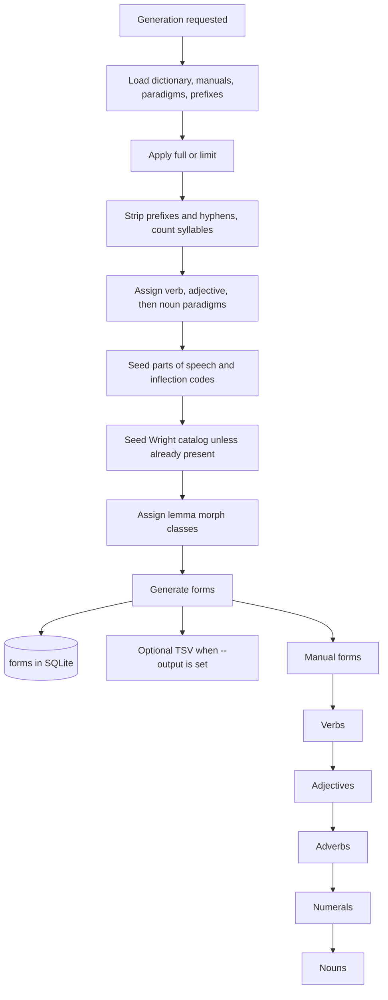

# Morphology generation

Generation is a stage of [[projects/wyrdcraeft/concepts/dictionary-build]], not its own `morphology build` command. It reads bundled files under `wyrdcraeft/etc/morphology` (dictionary TSV, manual forms, verbal paradigms, prefixes). Overrides are `--data-dir`, `--dictionary`, `--manual-forms`, `--verbal-paradigms`, and `--prefixes`.

The default artifact is rows in `forms` inside `wyrdcraeft.sqlite3`. Pass `--output` to also write a TSV. `--profile` prints stage and SQLite flush timings. `--refresh-catalog` reloads `wright_paradigms.json`. `--limit` caps a non-full run. R-stem nouns stay off unless enabled.

Correctness is judged against the grammar references in the repo, not against the old Perl generator.

## Flow

Lemma class assignment runs on dictionary-loaded lemmas before generation. Participles that verb generation later adds to the adjective pool are not assigned in that same run.

Verb generators are engines, not Wright conjugation classes. Strong is ablaut. Weak covers Weak I/II derivation, and item shape covers Weak III, preterite-present, and anomalous. Manual forms run first, as their own stage.

`wyrdcraeft morphology query --db PATH` reads generated rows from a SQLite file. `wyrdcraeft morphology clean-dictionary` backs up the morphology source TSV, fixes long diphthongs in column 2, lowercases all-uppercase titles, and drops duplicate rows.

`dictionary generate-reference-snapshots` writes compressed Python-reference snapshots, by default under `tests/python_reference/data`. That is a test artifact, not the app database.

## Scholarship

The design matches [[references/tichy-2017-morphological-analyser|Tichý 2017]]: a closed lemma list, class assignment, then paradigm expansion. His measured recall is 95 percent on 2,554 words of mostly late West Saxon prose, and he deliberately does not emit a dialect label on every cell or inflect compounds that are not already headwords. [[synthesis/Research: Old English Morphology Generation]] collects the later resources (Nerthus class fields, PaVeDa case frames, DOE attested spellings) that sit outside this stage. Class for a headword already in Nerthus is looked up in the guest database; the steps are [[skills/using-nerthus]]. Whether a generated spelling is attested is a separate search of the Dictionary of Old English Web Corpus ([[skills/using-doec]]). The corpus is not redistributed with this project.
