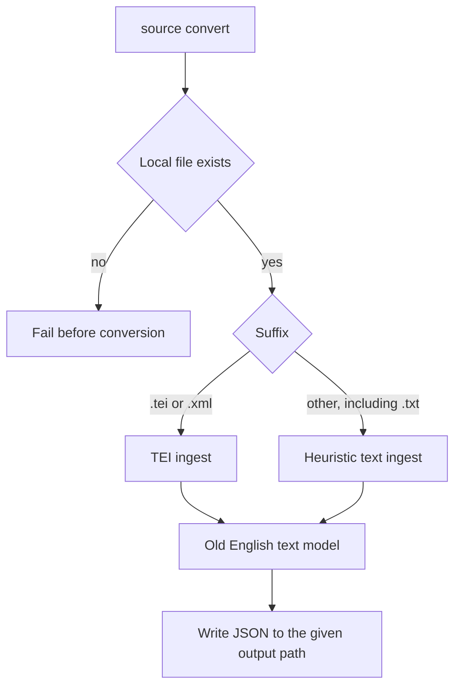

# Source conversion

`wyrdcraeft source convert <source> <output>` reads a local file that already exists and writes one JSON document to the path you give. An optional `--title` overrides the title. The command does not download anything and does not call a language model. That work left this repo with the OCR and messy-document pipeline. How to get a faithful markdown or TEI file out of a linguistic PDF, before this command sees it, is [[skills/linguistic-pdf-to-markdown]].

## Flow

TEI and XML go through the TEI ingestor. Everything else, including `.txt`, goes through the heuristic ingestor. Shared ingest behavior belongs on the general entrypoint, not on one caller.

This path is separate from dictionary indexing. [[entities/bosworth-toller]] source text is built by [[projects/wyrdcraeft/concepts/dictionary-build]], not by `source convert`.
