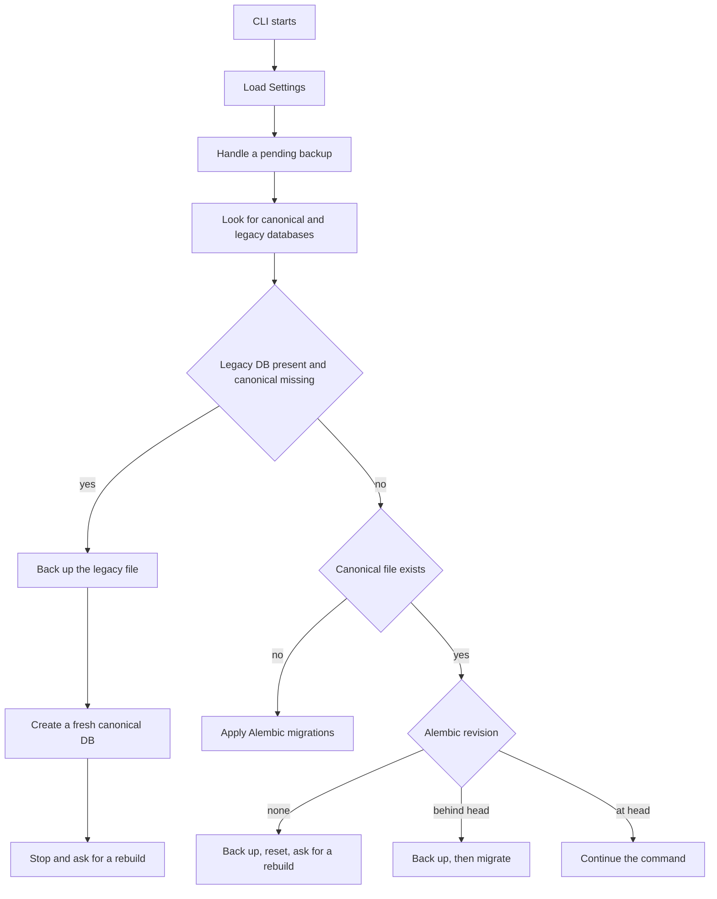

# Startup and settings

The root command builds one `Settings` object, stores it on the Click context, then runs the database readiness gate. Database commands assume that gate already ran. The gate is skipped for `version`, `settings`, `source`, and `diacritic` (`DATABASE_GATE_SKIP_COMMANDS` in `wyrdcraeft/cli/cli.py`), so those work with no database; only `morphology` and `dictionary` pass through it. Checked against the live repo on 2026-10-15 (HEAD 3b4915b). `wyrdcraeft settings` and `wyrdcraeft settings show` print the loaded values. `wyrdcraeft settings create` writes a `.wyrdcraeft.toml` file whose lines are JSON-encoded values, which is the current behavior of that command.

Flags such as `--verbose`, `--quiet`, `--config-file`, and `--output` are global. `--config-file` sets `WYRDCRAEFT_CONFIG_FILE` before settings load. Environment variables use the `WYRDCRAEFT_` prefix.

## Readiness gate

The canonical path is `wyrdcraeft.sqlite3` under the app-data directory. An app-data override changes that location. A legacy morphology database beside it is backed up and replaced; the command then stops with rebuild instructions instead of silently converting the old file.

Schema readiness is not the same as a populated index. After migrate, `bt_*` and `forms` can still be empty until [[projects/wyrdcraeft/concepts/dictionary-build]] runs.
