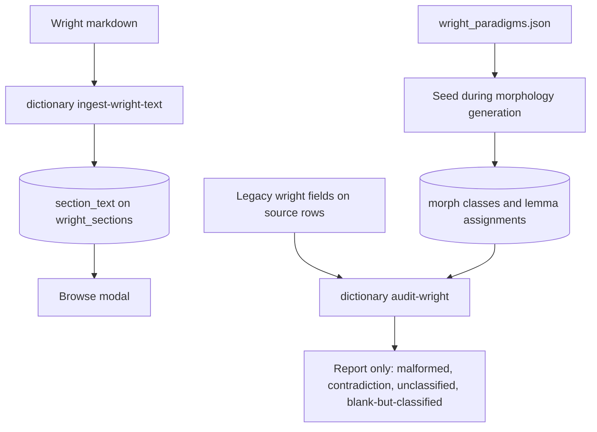

# Wright catalog

The catalog is reference data inside the same SQLite file as dictionary entries and generated forms. Canonical class assignment lives in `lemma_morph_classes`, keyed by normalized title and part of speech. The legacy `wright` field on source rows is audit input only.

`wright_paradigms.json` supplies morph classes, Wright section links, and bibliographic sources. Build seeds that fixture when catalog tables are empty. `--refresh-catalog` forces a reload. Paragraph text is not part of that seed.

Assignment priority, before form generation: paradigm or verb `paraID`, then part-of-speech features, then intersection with Wright sections at §330 or above. If none of those hit, the lemma gets no assignment row.

## Three processes

`wyrdcraeft dictionary ingest-wright-text --source PATH` parses `§ N` headings and fills empty `section_text` cells. `--force` overwrites. It reports markdown sections missing from the catalog, catalog sections still empty, and a coverage percent. The bundled `wright.md` currently has phonology §1–58 only, so inflection citations at §330 and above show an ingest-needed message until a fuller markdown file is ingested.

`wyrdcraeft dictionary audit-wright` compares legacy source `wright` values with the assigned classes. Categories are malformed legacy Wright, contradiction against the assigned section, unclassified lemma plus part of speech, and blank legacy field on a classified lemma. Version 1 does not rewrite sources and exits 0. `--json` prints the full result.

`docs/context/morphology.md` still names `morphology ingest-wright-text` and `morphology audit-wright`. The live commands are on `dictionary`.
