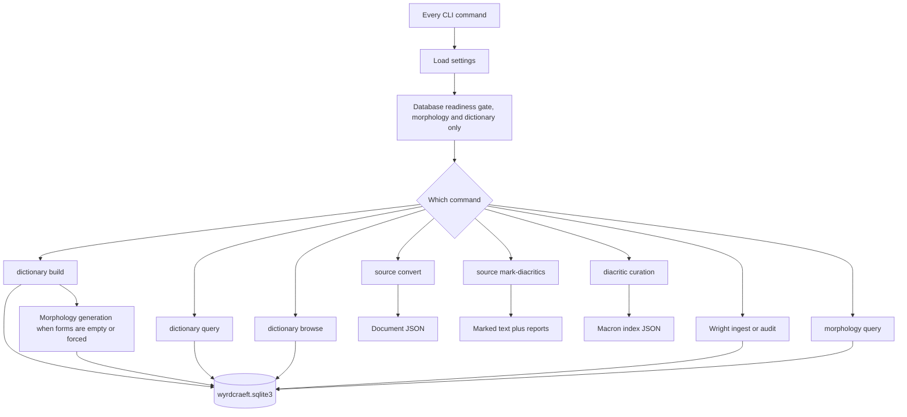

# wyrdcraeft

`wyrdcraeft` is a local Python CLI for [[concepts/old-english]] text. It converts source files, restores diacritics, builds a [[entities/bosworth-toller]] index, generates inflected forms, and browses dictionary entries beside those forms. One canonical SQLite file, `wyrdcraeft.sqlite3`, holds dictionary tables, morphology `forms`, and the Wright morph catalog.

These pages describe processes. They do not list internal symbols.

## How the processes fit

## Processes

- [[projects/wyrdcraeft/concepts/startup-and-settings]] — settings load and the Alembic readiness gate that runs before database commands.
- [[projects/wyrdcraeft/concepts/source-conversion]] — local `.txt` or TEI/XML into document JSON. No fetch and no LLM.
- [[projects/wyrdcraeft/concepts/diacritic-workflows]] — additive macron transfer, and curation of the macron index.
- [[projects/wyrdcraeft/concepts/dictionary-build]] — parse Bosworth-Toller, write `bt_*`, relink forms, regenerate morphology when needed.
- [[projects/wyrdcraeft/concepts/morphology-generation]] — paradigm assignment, Wright class assignment, then form stages into SQLite.
- [[projects/wyrdcraeft/concepts/dictionary-query-and-browse]] — lemma lookup, and the read-only Textual browse shell.
- [[projects/wyrdcraeft/concepts/wright-catalog]] — seed classes during build; ingest section prose and audit legacy Wright fields separately.

## Out of this repo

OCR, LLM ingest, and messy-document conversion live in `wordwending` (formerly `bochord`). ^[extracted]

## Session notes

Notes from 2026-10-08 cover how plans and CLI tests were checked. They do not describe the linguistic model.

- [[skills/verify-plan-in-throwaway-worktree]] — run a plan’s own code in a detached worktree before executing it on the main tree.
- [[skills/claude-code-builtin-cd]] — `builtin cd` so pytest imports the worktree package, not the editable main checkout.
- [[skills/click-clirunner-rich-stderr]] — CliRunner misses Rich stderr consoles bound at import; monkeypatch the print helper.

## Related

- [[concepts/old-english-grammar]] — the inflectional system the generator is written against.
- [[concepts/oe-word-formation]] — affix and compound patterns beside the generator, not a description of it. ^[inferred]
- [[projects/aenglisc-toolkit/aenglisc-toolkit]] — neighbouring OE reading app; Qt, not this CLI.
