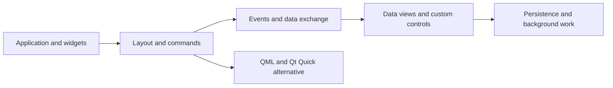

# Beginning PyQt (Willman, 2022): a connected reading guide

Joshua M. Willman’s *Beginning PyQt: A Hands-on Approach to GUI Programming with PyQt6* (Apress, 2022) teaches desktop GUI construction through worked projects. The supplied clippings cover chapters 1–15 and the back matter. They add implementation vocabulary to the vault’s [[references/interaction-design-5th-edition|interaction-design reading map]].

## Read by the problem you need to solve

| Chapters | Distilled topic |
| --- | --- |
| 1, 2, 3 | [[skills/pyqt6-widget-application-basics|Building an event-driven PyQt6 widget application]] |
| 4 | [[skills/pyqt6-layout-management|Choosing and combining Qt widget layouts]] |
| 5 | [[skills/pyqt6-actions-and-main-windows|Qt main windows, shared actions, and dialogs]] |
| 6 | [[skills/pyqt6-styles-and-widget-grouping|Qt widget styling, grouping, and tabs]] |
| 7 | [[skills/pyqt6-signals-and-event-handlers|Qt signals, slots, and event handlers]] |
| 8 | [[skills/pyqt6-designer-workflow|Qt Designer forms and separate application behavior]] |
| 9 | [[skills/pyqt6-clipboard-and-mime-data|Qt clipboard access and MIME-aware data transfer]] |
| 10 | [[skills/pyqt6-item-widgets-and-drag-drop|Qt item widgets, tables, trees, and drag-and-drop]] |
| 11 | [[skills/pyqt6-painting-and-property-animation|Qt painting, graphics scenes, and property animation]] |
| 12 | [[skills/pyqt6-custom-widgets|Reusable Qt controls through composition and specialization]] |
| 13 | [[skills/pyqt6-qml-and-qt-quick|Qt Quick, QML components, and Python loading]] |
| 14 | [[skills/pyqt6-model-view-and-sql|Qt model/view, delegates, and SQL-backed editing]] |
| 15 | [[skills/pyqt6-responsive-background-work|Responsive Qt interfaces and background work]] |

## The construction path

This is a reading synthesis, not a mandatory implementation order. ^[inferred]

## Integrate with the rest of the vault

[[projects/aenglisc-toolkit/concepts/qt-app-design-references]] provides desktop applications and component references. This book supplies smaller instructional examples for interpreting them. [[concepts/ux-conceptual-models]] and [[skills/ux-evaluation-planning]] remain the complementary tools for deciding what to build and whether it serves users. ^[inferred]

The book uses PyQt6. The existing aenglisc_toolkit notes concern a PySide application; shared Qt concepts do not establish identical Python binding syntax or justify replacing its existing architecture. ^[inferred]

## Source quality and limits

All chapter clippings come from one book and count as one evidence lineage. The back matter is an index and lookup aid, not independent corroboration of the chapters. Several clippings repeat sections or include extraction artifacts such as escaped underscores and disrupted code indentation; these were distilled once while the originals were preserved.

The Designer prose conflicts with its displayed composition example, the data-widget recap contains a class-name inconsistency, and the graphics discussion varies the animation-class spelling. These are recorded on the affected topic pages. The threading example also leaves cancellation and filesystem recovery concerns unresolved.

This ingest extracts the book’s conceptual structure and selected mechanisms. It does not reproduce a complete code edition, execute the example projects, validate every API spelling, or update 2022 installation instructions. Chapter 16 is mentioned in the supplied text and index but was not supplied as a chapter clipping.

## Sources

- [[_raw/_archived/1. Getting Started with PyQt.md]]
- [[_raw/_archived/2. Building a Simple GUI.md]]
- [[_raw/_archived/3. Adding More Functionality with Widgets.md]]
- [[_raw/_archived/4. Learning About Layout Management.md]]
- [[_raw/_archived/5. Menus, Toolbars, and More.md]]
- [[_raw/_archived/6. Styling Your GUIs.md]]
- [[_raw/_archived/7. Handling Events in PyQt.md]]
- [[_raw/_archived/8. Creating GUIs with Qt Designer.md]]
- [[_raw/_archived/9. Working with the Clipboard.md]]
- [[_raw/_archived/10. Presenting Data in PyQt.md]]
- [[_raw/_archived/11. Graphics and Animation in PyQt.md]]
- [[_raw/_archived/12. Creating Custom Widgets.md]]
- [[_raw/_archived/13. Working with Qt Quick.md]]
- [[_raw/_archived/14. Introduction to Handling Databases.md]]
- [[_raw/_archived/15. Managing Threads.md]]
- [[_raw/_archived/Back Matter.md]]
