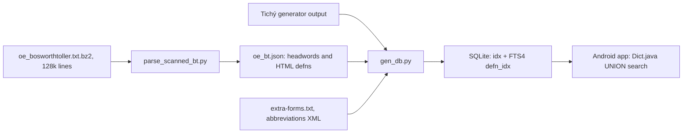

# btc_anglo_saxon

Madeleine Thompson's "Bosworth-Toller/Charles Anglo-Saxon Dictionary". A Python build pipeline produces a roughly 71 MB SQLite database (about 10 minutes to build), which a Java Android app searches.

## Pieces

- **`db/parse_scanned_bt.py`** stitches the page-based scan into entries. It has hard-coded line-number override lists, so it is tied to this exact snapshot of the scan.
- **`db/normalize.py`** (`ascify`: þ/ð to `th`, æ to `ae`, strip diacritics) is mirrored in the Java `Dict.normalizeQuery`, giving spelling-insensitive lookup.
- **`inflect/generation.py`** is a small verb rule engine. YAML categories inherit from a parent; a rule is a format string like `{root}aþ` or a regex rewrite. About 140 verbs by class in `words.yaml`, 7 explicit irregulars. `wikidata.yaml` (Wikibooks tables) is an independent test oracle, and `make_table.py` asserts rule output and explicit forms agree.
- **Search** is one UNION query: FTS phrase search plus prefix search over terms, scored by a heuristic (Modern English match +5, exact term +2, and so on).

## Gaps and licence

- Noun and adjective inflection is not in the repo. `db/build_dict_db.sh` expects `generator-output.txt` from the external [[entities/ondrej-tichy|Tichý]] generator; only a 625-byte test file is checked in.
- Code MIT, data public domain, documented in `LICENSE.md`. Python tests, Java instrumented tests, flake8, isort, `mypy --strict`, black. Last commit 2025-07-06.

## Use for wyrdcraeft

The rule-plus-oracle design is the transferable part: validate generated paradigms against an independent source. The BT parser and `ascify` normalisation are relevant to [[projects/wyrdcraeft/concepts/dictionary-build]], and the data lineage is the same [[entities/bosworth-toller|Bosworth-Toller]] scan used elsewhere (see [[references/oe-dictionary-repos]]).

## Sources

- [[_raw/_archived/GITHUB btc_anglo_saxon 2026-10-15]]
- Repo read directly on 2026-10-15 (shallow clone, nothing executed).
