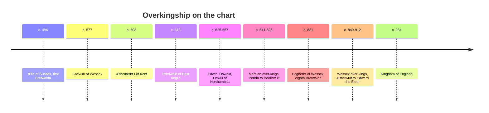

# Heptarchy ruler timeline, 450 to 955

`Heptarchy_v2.pdf` is an Excel chart (author field "Rob", 13 landscape pages). Rows are years, columns are Kent, Sussex, Northumbria, Mercia, Wessex, Essex and East Anglia, and coloured blocks mark who ruled. It is a schematic: reigns appear as labelled blocks without stated dates, and the chart cites no sources. It was read by extracting each label's position, then mapping it to the nearest year row, so the years below are **approximate positions on the chart, not reign dates**. ^[inferred] Treat them as a map of order and overlap, and check dates against a proper source before relying on them. The chart is the same schematic the vault flags as an open question on [[concepts/anglo-saxon-kingdoms]]: whether "Heptarchy" is later tidiness.

## Bretwaldas as labelled

| No. | Ruler | Kingdom | Chart position |
|---|---|---|---|
| 1 | Ælle | Sussex | c. 496 |
| 2 | Caewlin | Wessex | c. 577 |
| 3 | Æthelberht I | Kent | c. 603 |
| 4 | Rædwald | East Anglia | c. 613 |
| 5 | Edwin | Northumbria | c. 625 |
| 6 | Oswald | Northumbria | c. 638 |
| 7 | Oswiu | Northumbria | c. 657 |
| 8 | Ecgberht | Wessex | c. 821 |

## Ruler sequences by kingdom

Order is the chart's. Positions are approximate years where a label first appears.

- **Kent:** Hengist and Horsa (c. 469), Oisc (c. 500), Octa (c. 526), Eormenric (c. 565), Æthelberht I (c. 602), Eadbald (c. 628), Eorcenberht and Eormenred (c. 652), Ecgberht I (c. 669), Hlothhere (c. 679), Eadric (c. 686), Mul of Wessex, Swæfheard, Swæfberht and Oswine, Wihtred (c. 709). From c. 743 several co-rulers, then Offa of Mercia (c. 766), Ecgberht II, Ealhmund, Eadberht III Præn, Cuthred (c. 799, appointed by Mercia), Coenwulf and Ceolwulf I of Mercia, Baldred (c. 825), Ecgberht of Wessex (c. 833). Subsumed into Wessex c. 883.
- **Sussex:** founded c. 477 with Ælle; Cissa (c. 541); a stretch marked "no information"; Æthelwealh (c. 672); then Eadric of Kent, Berthun and Andhun, Nothhelm (Nunna) and others in co-reigns; Æthelberht (c. 743); Oswald, Osmund, Oslac, Ælfwald (c. 764); Offa of Mercia (c. 784); Coenwulf, Ceolwulf I, Beornwulf of Mercia; Ecgberht of Wessex (c. 832). Subsumed into Wessex c. 883.
- **Northumbria:** Bernicia and Deira shown separately early: Esa/Oesa, Eoppa and Ida (Bernicia), Ælla (c. 573, Deira). Æthelfrith (c. 604), Edwin (c. 624), Oswald (c. 637), Oswiu (c. 656), Ecgfrith (c. 678), Aldfrith (c. 695), Eadwulf I, Osred I, Coenred, Osric, Ceolwulf (c. 733), Eadberht (c. 748), Oswulf, Æthelwald Moll, Alhred, Æthelred I, Ælfwald I, Osred II, Osbald, Eardwulf (c. 799), Ælfwald II, Eanred (c. 832), Æthelred II, Rædwulf, Osberht and Ælla (c. 865), then Viking rule in the south and Ecgberht I in the north, Ricsige (c. 874). The chart notes that full control of Northumbria was not established until 954.
- **Mercia:** founded c. 483; Icel, Cnebba, Cynewald, Creoda, Pybba, Cearl, Penda (c. 640), Paeda, Oswiu of Northumbria, Wulfhere (c. 666), Æthelred I (c. 690), Cœnred, Ceolred, Æthelbald (c. 736), Offa (c. 776), Cœnwulf (c. 808), Ceolwulf I, Beornwulf, Ludeca, Wiglaf, Ecgberht of Wessex (c. 830), Wiglaf restored, Beorhtwulf, Burgred (c. 863), Ceolwulf II (c. 877). Subject to Wessex control c. 903.
- **Wessex:** founded c. 484; Cerdic (c. 526), Cynric (c. 547), Caewlin, Ceol, Ceolwulf, Cynegils (c. 627), Cenwalh (c. 644, with Penda of Mercia ruling for a time and Cenwalh restored c. 660), Queen Seaxburh, Æscwine, Centwine, Cædwalla, Ine (c. 707), Æthelheard, Cuthred, Sigeberht, Cynewulf (c. 772), Beorhtric (c. 794), Ecgberht (c. 820), Æthelwulf, Æthelbald, Æthelberht, Æthelred I, [[entities/alfred-the-great|Alfred the Great]] (c. 885), Edward the Elder (c. 911), Æthelstan, Edmund I, Edred.
- **Essex:** founded c. 487; Æscwine (c. 556), Siedd, Sæberht (c. 610), Sexraed and Sæward with co-rulers, Sigeberht the Little (c. 638), Sigeberht the Good, Swithhelm, then co-rulers Sighere, Sæbbi, Sigiheard and Swaefred; from c. 688 under Mercian domination; Sælred, Swithred, Sigeric, Sigered; direct Mercian rule c. 818; subsumed into Wessex c. 876.
- **East Anglia:** founded c. 500; Wehha (c. 561), Wuffa, Tytila, Rædwald (c. 612), Eorpwald, Ricberht, Sigeberht, Ecgric, Anna (c. 643), Æthelhere, Æthelwold, Ealdwulf (c. 689), Ælfwald (c. 731), Beonna and Æthelberht II, then under Mercian domination, Æthelred I, Offa of Mercia (direct rule c. 795), Eadwald, repeated Mercian rule, Æthelstan (c. 836), Æthelweard, (Saint) Edmund (c. 862), Oswald, Viking domination from c. 872, Æthelred II. Subsumed into Wessex c. 922.

## What the chart shows

- **Mercian over-kingship** runs from Penda (c. 641) through Wulfhere, Æthelbald, Offa, Cœnwulf and Ceolwulf I, with Essex, Kent, Sussex and East Anglia repeatedly under Mercian domination or direct rule. This is the period behind [[entities/offa-of-mercia]].
- **Wessex over-kingship** is marked from Æthelwulf (c. 849) through Edward the Elder (c. 912), and the three southeastern kingdoms are absorbed in turn: Essex c. 876, Kent and Sussex c. 883, Mercia c. 903, East Anglia c. 922.
- **Kingdom of England** is labelled from c. 934, under Æthelstan, Edmund I and Edred. That is the polity [[concepts/kingdom-of-the-english]] describes for Wulfstan's day. Page 13 of the chart has a column layout I did not fully reconcile, so I use only the Wessex and "Kingdom of England" labels there. ^[ambiguous]

## Limits

No sources, no stated reign dates, and spelling of names is the chart's own (for example "Cœnred" and "Coenwulf"). Not read as a visual beyond the first page. Some labels span several rows, so my year positions can be off by a few years. ^[inferred]

## Related

- [[concepts/anglo-saxon-kingdoms]]
- [[concepts/old-english-dialects]]
- [[entities/aethelred-the-unready]]

## Sources

- [[_raw/_archived/Heptarchy_v2.pdf]]
