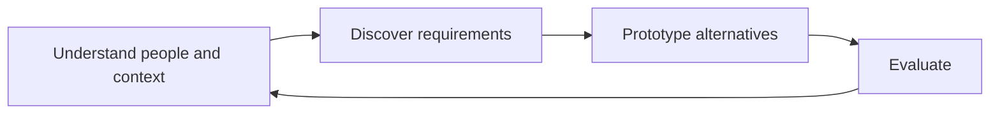

# Interaction Design, fifth edition

Helen Sharp, Jennifer Preece, and Yvonne Rogers’s textbook connects understanding users to designing and evaluating interactive products. These notes distill the local chapter clippings, rather than reproduce their examples or bibliography. The clippings cite the 2019 fifth edition; their `published` metadata says 2026-08-01 and should not be treated as the edition’s publication date.

## Reading map

- [[concepts/ux-conceptual-models]] — chapter 3.
- [[concepts/ux-cognition]] — chapter 4.
- [[concepts/ux-social-interaction]] — chapter 5.
- [[concepts/ux-emotional-interaction]] — chapter 6.
- [[concepts/ux-interface-selection]] — chapter 7.
- [[skills/ux-data-gathering]] — chapter 8.
- [[skills/ux-data-analysis]] — chapter 9.
- [[concepts/ux-data-at-scale]] — chapter 10.
- [[skills/ux-requirements-discovery]] — chapter 11.
- [[skills/ux-prototyping]] — chapter 12.
- [[concepts/ux-agile-practice]] — chapter 13.
- [[skills/ux-evaluation-planning]] — chapter 14.
- [[skills/ux-usability-and-field-studies]] — chapter 15.
- [[skills/ux-inspections-and-models]] — chapter 16.

## Workflow

The loop is a synthesis of the chapters’ iterative account. ^[inferred]

## Connections to this vault

[[projects/aenglisc-toolkit/aenglisc-toolkit]] supplies an application context for these methods, while [[concepts/paired-group-oral-assessment]] is a separate example of evaluation whose interaction conditions matter. These connections are proposed applications, not studies reported by the textbook. ^[inferred]

## Evidence limits

The bibliography locates works cited by the authors; it does not establish that those works were read during this ingest. Chapters from the same textbook count as one evidence lineage for confidence. Chapters 1–2 were not supplied.

## Sources

- [[_raw/_archived/Chapter 3 CONCEPTUALIZING INTERACTION.md]]
- [[_raw/_archived/Chapter 4 COGNITIVE ASPECTS.md]]
- [[_raw/_archived/Chapter 5 SOCIAL INTERACTION.md]]
- [[_raw/_archived/Chapter 6 EMOTIONAL INTERACTION.md]]
- [[_raw/_archived/Chapter 7 INTERFACES.md]]
- [[_raw/_archived/Chapter 8 DATA GATHERING.md]]
- [[_raw/_archived/Chapter 9 DATA ANALYSIS, INTERPRETATION, AND PRESENTATION.md]]
- [[_raw/_archived/Chapter 10 DATA AT SCALE.md]]
- [[_raw/_archived/Chapter 11 DISCOVERING REQUIREMENTS.md]]
- [[_raw/_archived/Chapter 12 DESIGN, PROTOTYPING, AND CONSTRUCTION.md]]
- [[_raw/_archived/Chapter 13 INTERACTION DESIGN IN PRACTICE.md]]
- [[_raw/_archived/Chapter 14 INTRODUCING EVALUATION.md]]
- [[_raw/_archived/Chapter 15 EVALUATION STUDIES FROM CONTROLLED TO NATURAL SETTINGS.md]]
- [[_raw/_archived/Chapter 16 EVALUATION INSPECTIONS, ANALYTICS, AND MODELS.md]]
- [[_raw/_archived/Interaction Design 5e - References.md]] — bibliography snapshot.
