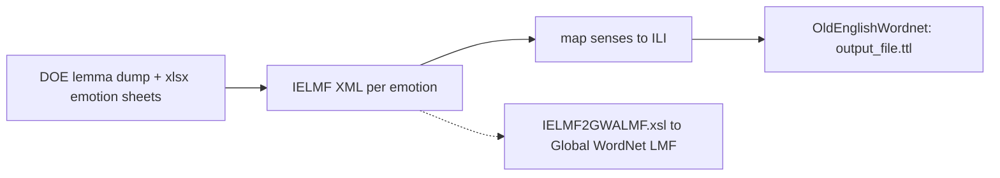

# Old English WordNet repos (anasfkhan81)

`OldEnglish`, `OldEnglishWordnet`, and [[references/oldenglishmorphology-shacl|OldEnglishMorphology]] are by the same author. The first two are one pipeline.

## OldEnglish (working materials)

A scratch workspace, not a package. 22 files: six xlsx emotion-category sheets; seven hand-edited LMF XML files (`Anger.xml` 182 entries, `shame.xml` 166, `Pride.xml` 133, and four smaller); `dic_lemmas_senseII.csv` (about 47k lines, a DOE lemma dump) and `lemmas.txt` (about 34.5k headwords). `WN-IELMF-0.DTD` is an extended Kyoto LMF schema carrying gender and etymology, and `IELMF2GWALMF.xsl` is a draft downconverter. Its `partOfSpeech` XPath resolves to the first entry only. `emotion_ili.py` uses the `wn` library to list English emotion synsets with ILI ids, but is never called. GPL-3, last commit 2024-04-12.

## OldEnglishWordnet (the export)

Data only: `output_file.ttl`, 33,620 lines, in OntoLex-Lemon with Global WordNet extensions. 1,522 lexical entries, 2,349 senses, 1,027 `:olde_N` concepts linked to ILI ids. Each sense has an English definition and a `wn:note` with the emotion category (Worry-Fear, Embarrassment-Shame, Sadness-Despair, and others).

- No `hypernym` or `skos:broader` links, so it is a flat emotion lexicon, not a wordnet in the usual sense.
- Some concepts have empty definitions or malformed ILI ids (`i9385??`). The base URI is `http://example.org/olde/`.
- No licence file. Last commit 2025-01-08.

## Use

A small OE-to-ILI sense lookup for emotion vocabulary, loadable with rdflib. `lemmas.txt` could check headword coverage against wyrdcraeft's dictionary, but DOE reuse terms are unclear (see [[entities/dictionary-of-old-english]]).

## Sources

- [[_raw/_archived/GITHUB OldEnglish 2026-10-15]]
- [[_raw/_archived/GITHUB OldEnglishWordnet 2026-10-15]]
- Repos read directly on 2026-10-15 (shallow clones, nothing executed).
