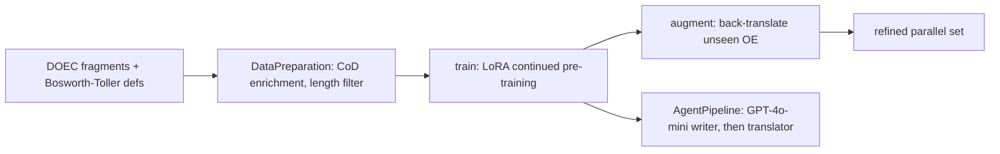

# OldEnglish-LLM

Code for the paper "AI-Driven Generation of Old English: A Framework for Low-Resource Languages" (Salazar, Nuñez, López, Martin). Four Colab-style notebooks; last commit 2025-07-24; no licence, no tests, no evaluation code.

## What the code does

- **Data prep:** DOEC (about 3M words), a DOEC subset with Modern English translations, and Bosworth-Toller definitions from a local MySQL view. Normalisation maps accented vowels to plain ones but keeps æ þ ð ƿ. Chain-of-Dictionary enrichment appends word glosses to fragments, sampling low-frequency words more often. Fragments outside the Q1–Q3 length band are dropped. Tags: `[ANG]`, `[EN]`, `[INST]`.
- **Training:** `unsloth/Meta-Llama-3.1-8B-bnb-4bit`, LoRA r=256, alpha=32, rsLoRA, including `embed_tokens` and `lm_head`; lr 1e-4, 5 epochs, effective batch 32, max length 2048.
- **Augmentation:** greedy translation of the held-out half, filtered by length and by rejecting English output that contains OE characters.
- **"Dual-agent" demo:** a fixed chain of two LangChain tools, not an agent loop.

## Caveats

Data files are missing (`DOECByFragmentTextOnly.txt` and others) and the published model id is referenced but not shipped. DOEC is access-restricted, and the repo does not address licensing. The paper's quality claims cannot be checked from the repo.

## Use

The reusable ideas are the CoD recipe and the data filters. Training on DOEC-style normalised spelling means outputs may not match your own orthography.

## Sources

- [[_raw/_archived/GITHUB OldEnglish-LLM 2026-10-15]]
- Repo read directly on 2026-10-15 (shallow clone, nothing executed).
